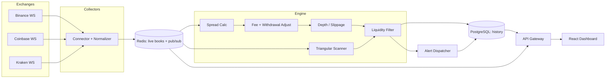
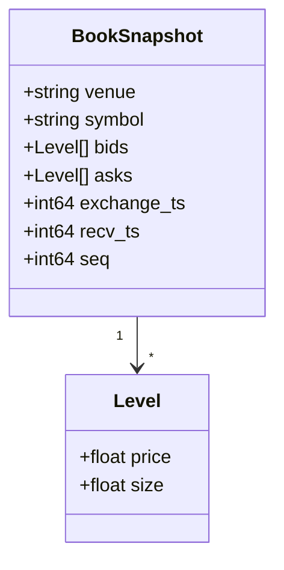

# Crypto Arbitrage Monitor — Project Plan

A real-time **monitoring** system that streams order books from multiple crypto
exchanges, computes **fee- and slippage-adjusted** spreads, filters out
illiquid/unexecutable opportunities, raises alerts, and stores an opportunity
history so you can study how arbitrage edges appear and **decay** over time.

> **Disclaimer:** This is a **monitoring and analytics** tool only. It observes
> public market data and reports *theoretical* spreads net of fees. It does
> **not** place orders, custody funds, give trading advice, or guarantee that any
> displayed opportunity is executable. Latency, withdrawal limits, KYC, and
> market movement routinely erase raw spreads.

---

## 1. Goals & Scope

| Goal | Description |
|------|-------------|
| Realistic | Always report spreads **net of taker fees, withdrawal costs, and book slippage** — never raw mid-vs-mid. |
| Real-time | Low-latency WebSocket ingestion with a normalized, in-memory book per venue. |
| Honest | Surface liquidity depth and opportunity lifetime so "edges" aren't overstated. |
| Auditable | Persist every detected opportunity with the inputs that produced it. |

**Out of scope (v1):** order placement / execution, wallet or exchange API keys
with trade scope, funding-rate & derivatives arbitrage, cross-chain bridging
mechanics. Read-only public market data only.

---

## 2. Architecture



**Pattern:** Stateless **connectors** normalize each venue into a common
order-book schema pushed to **Redis** (hot state + pub/sub). A detection
**engine** subscribes, computes net spreads against real book depth, filters by
liquidity, dispatches **alerts**, and writes an **opportunity history** to
PostgreSQL for later decay/latency analysis.

---

## 3. Tech Stack

| Layer | Choice | Purpose |
|-------|--------|---------|
| Collectors | Node.js (TypeScript) | Efficient concurrent WebSocket clients |
| Engine/API | Python 3.11 + FastAPI | Analytics + REST/WS gateway |
| Exchange libs | `ccxt` / native WS APIs | Unified market data |
| Hot state | Redis 7 (+ Streams/PubSub) | Live books, dedup, alert fan-out |
| History | PostgreSQL 15 + TimescaleDB (optional) | Opportunity & spread time-series |
| Validation | Pydantic v2 / Zod | Schema safety on both runtimes |
| Numerics | NumPy, pandas | Depth integration, stats |
| Alerts | WebSocket + webhook (Slack/Discord/email) | Notifications |
| Frontend | React (Vite + TypeScript) | Dashboard |
| Charts | Plotly.js / Recharts | Spread series, depth, history |
| Testing | pytest, vitest | Unit + integration |
| Tooling | ruff/black/mypy, eslint/prettier | Lint, format, types |

---

## 4. Repository Structure

```
crypto-arbitrage-monitor/
├── PLAN.md                       # this file
├── README.md
├── docker-compose.yml            # redis + postgres + api + collectors
├── collectors/                   # Node.js (TypeScript)
│   ├── package.json
│   └── src/
│       ├── index.ts
│       ├── exchanges/
│       │   ├── base.ts           # Connector interface
│       │   ├── binance.ts
│       │   ├── coinbase.ts
│       │   └── kraken.ts
│       ├── normalize.ts          # → common book schema
│       └── publish.ts            # → Redis
├── engine/                       # Python
│   ├── pyproject.toml
│   ├── app/
│   │   ├── main.py               # FastAPI + WS gateway
│   │   ├── config.py             # fees, venues, thresholds
│   │   ├── redis_io.py
│   │   ├── db.py
│   │   ├── models/               # ORM: opportunity, spread_tick, venue_fee
│   │   ├── schemas/
│   │   ├── api/
│   │   │   ├── routes_live.py
│   │   │   ├── routes_opportunities.py
│   │   │   ├── routes_history.py
│   │   │   └── ws_feed.py
│   │   └── core/                # PURE analytics, no I/O
│   │       ├── book.py           # order-book model
│   │       ├── spread.py         # cross-venue spread
│   │       ├── fees.py           # taker + withdrawal model
│   │       ├── depth.py          # VWAP fill / slippage vs depth
│   │       ├── liquidity.py      # filters
│   │       ├── triangular.py     # 3-leg cycle scanner
│   │       └── latency.py        # staleness / latency metrics
│   └── tests/
│       ├── test_spread.py
│       ├── test_fees.py
│       ├── test_depth.py
│       ├── test_triangular.py
│       └── test_liquidity.py
└── frontend/
    ├── package.json
    └── src/
        ├── App.tsx
        ├── api/client.ts
        ├── components/
        │   ├── LiveSpreadTable.tsx
        │   ├── DepthLadder.tsx
        │   ├── OpportunityHistory.tsx
        │   ├── TriangularView.tsx
        │   └── LatencyPanel.tsx
        └── types/api.ts
```

---

## 5. Common Order-Book Schema



Bids are sorted descending, asks ascending. `recv_ts - exchange_ts` feeds the
**latency/staleness** metric; stale books are excluded from detection.

---

## 6. The Math (Detection Engine)

### 6.1 Raw cross-venue spread

For a symbol quoted on venue $A$ (buy) and venue $B$ (sell), using **executable**
top-of-book prices (best ask on $A$, best bid on $B$):

$$\text{spread}_{\text{raw}} = \frac{P^{\text{bid}}_{B} - P^{\text{ask}}_{A}}{P^{\text{ask}}_{A}}$$

### 6.2 Fee-adjusted profitability

Let $f^{t}_A, f^{t}_B$ be taker fees and $w_B$ the per-unit withdrawal/transfer
cost. Buying on $A$ and selling on $B$:

$$\Pi_{\text{net}} = \underbrace{P^{\text{bid}}_{B}(1 - f^{t}_{B})}_{\text{proceeds}}
- \underbrace{P^{\text{ask}}_{A}(1 + f^{t}_{A})}_{\text{cost}} - w_B$$

$$\text{spread}_{\text{net}} = \frac{\Pi_{\text{net}}}{P^{\text{ask}}_{A}(1 + f^{t}_A)}$$

An opportunity is reported only when $\text{spread}_{\text{net}} > \theta$ (a
configurable threshold).

### 6.3 Depth-aware fill (slippage)

Top-of-book is a mirage for any real size. To trade quantity $Q$, walk the book
and compute the **volume-weighted** fill price:

$$\bar{P}_{\text{ask}}(Q) = \frac{1}{Q}\sum_{k} p_k \min\!\big(q_k,\; Q - \textstyle\sum_{j<k} q_j\big)$$

Slippage versus best price:

$$\text{slip}(Q) = \frac{\bar{P}_{\text{ask}}(Q) - P^{\text{ask}}_{\text{best}}}{P^{\text{ask}}_{\text{best}}}$$

Profit is recomputed with $\bar{P}_{\text{ask}}(Q)$ and $\bar{P}_{\text{bid}}(Q)$,
so the engine reports the **maximum executable size** for which
$\text{spread}_{\text{net}}(Q) > \theta$.

### 6.4 Liquidity filter

Reject an opportunity unless, on both legs:

$$\sum_{k=1}^{D} q_k \ge Q_{\min} \quad\text{and}\quad \text{book age} \le \Delta_{\max}$$

i.e. at least $Q_{\min}$ available within the top $D$ levels and a fresh
(non-stale) book.

### 6.5 Triangular arbitrage (single venue)

For a 3-currency cycle $A \to B \to C \to A$ using best executable rates
$r_{AB}, r_{BC}, r_{CA}$ and per-trade taker fee $f$:

$$\rho = r_{AB}\,r_{BC}\,r_{CA}\,(1-f)^3$$

A theoretical edge exists when $\rho > 1$; the reported net edge is $\rho - 1$.
Each leg is also checked against book depth via §6.3.

### 6.6 Latency / staleness

$$\ell = t_{\text{recv}} - t_{\text{exchange}}, \qquad \text{age} = t_{\text{now}} - t_{\text{recv}}$$

Distributions of $\ell$ per venue are tracked; books with `age > Δ_max` are
ignored so the monitor never reports spreads built on stale quotes.

### 6.7 Opportunity decay (lifetime)

Each opportunity is timestamped on detection and resolution. Define lifetime
$T_{\text{life}} = t_{\text{close}} - t_{\text{open}}$ and fit the survival /
decay of net spread:

$$\text{spread}_{\text{net}}(t) \approx s_0\, e^{-\lambda (t - t_0)}, \qquad
\bar{T}_{\text{life}} = \frac{1}{\lambda}$$

so the dashboard can answer "how long do these edges typically last?".

---

## 7. Alerting

- **Triggers:** `spread_net > θ`, sustained for $\ge n$ ticks, passing liquidity
  and freshness filters.
- **Channels:** in-app WebSocket toast, plus optional Slack/Discord/email webhook.
- **Throttling:** debounce per (symbol, venue-pair) to avoid alert storms;
  collapse repeats into a single updating alert with a lifetime counter.

---

## 8. API Design (REST + WS)

| Method | Endpoint | Returns |
|--------|----------|---------|
| GET | `/api/live/spreads` | current net spreads across venue pairs |
| GET | `/api/live/book/{venue}/{symbol}` | normalized depth ladder |
| GET | `/api/opportunities` | filtered current opportunities |
| GET | `/api/opportunities/{id}` | full inputs + computed economics |
| GET | `/api/history` | historical opportunities (time/symbol filters) |
| GET | `/api/triangular/{venue}` | live 3-leg cycles with $\rho - 1$ |
| GET | `/api/latency` | per-venue latency stats |
| WS  | `/ws/feed` | streaming spreads, opportunities, alerts |

---

## 9. Frontend Features

- **Live Spread Table** — venue-pair × symbol grid of net spreads, color-scaled,
  with max executable size and slippage.
- **Depth Ladder** — side-by-side order books for a chosen pair with the
  fillable quantity highlighted.
- **Opportunity History** — table + timeline of past opportunities with lifetime.
- **Triangular View** — live cycles with the $\rho - 1$ edge and per-leg depth.
- **Latency Panel** — per-venue latency distributions and staleness flags.

---

## 10. Validation & Testing

- **Synthetic books** — hand-crafted ladders with known VWAP fills assert exact
  slippage and net-spread math.
- **No-free-lunch tests** — equal prices + nonzero fees must yield
  $\text{spread}_{\text{net}} < 0$ (no false opportunities).
- **Triangular identity** — a consistent rate triple yields $\rho \approx 1$.
- **Staleness** — books older than $\Delta_{\max}$ are provably excluded.
- **Replay harness** — record real WS streams and replay deterministically in CI.

---

## 11. Roadmap

| Phase | Deliverable |
|-------|-------------|
| 0 | Repo, Docker, Redis/Postgres, common book schema |
| 1 | One exchange connector → normalized book in Redis |
| 2 | Cross-venue spread + fee model + tests |
| 3 | Depth-aware slippage + liquidity filter |
| 4 | Opportunity persistence + history API |
| 5 | Multi-venue connectors + triangular scanner |
| 6 | Alerts (WS + webhook) with throttling |
| 7 | React dashboard (spreads, depth, history, latency) |
| 8 | Latency + decay analytics, polish, README + demo |

---

## 12. Resume Bullet

> Built a crypto **arbitrage monitoring** system that streams multi-exchange
> order books over WebSockets, computes **fee- and slippage-adjusted** spreads
> against real book depth, filters opportunities by **liquidity**, scans
> **triangular** cycles, and tracks **opportunity decay** and per-venue latency —
> persisting a full opportunity history for analysis.
