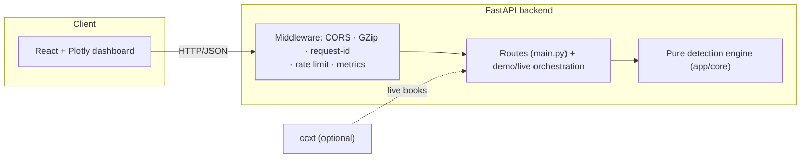
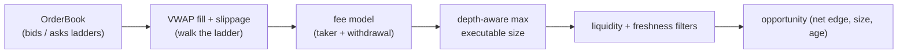

# Architecture

This document explains how the Crypto Arbitrage Monitor is built: the pure
detection engine, the depth-aware spread/slippage model, the cross-venue and
multi-hop (Bellman-Ford) arbitrage search, and the API/observability layers.

> For *what* it does and how to run it, see the [README](../README.md); for the
> math and the production design, see [PLAN.md](../PLAN.md). This document is the
> *how and why*.

> **Monitoring / analytics only** — theoretical spreads net of fees and book
> slippage. No orders are placed.

---

## 1. Design goals

1. **A pure detection engine.** Everything in `app/core/` is plain NumPy with no
   FastAPI and no I/O; the API, dashboard, live adapter, and tests share it.
2. **Honest spreads.** Edges are computed against *real book depth* — VWAP fills
   walk the ladder, then fees and slippage are subtracted — so a reported edge is
   the size-aware, executable one, not a top-of-book mirage.
3. **Freshness & liquidity gating.** Stale or thin books are filtered out before
   an opportunity is reported.

---

## 2. System overview



`app/core` never imports the API layer.

---

## 3. The pricing/spread pipeline



| Stage | Module | Role |
| ----- | ------ | ---- |
| Book | `core/book.py` | normalized bids/asks, best bid/ask, mid |
| Fill | `core/depth.py`, `core/spread.py` | VWAP fill walking depth; slippage vs top of book |
| Fees | `core/fees.py` | taker + withdrawal fee schedule |
| Filters | `core/liquidity.py` | min-quantity and max-age (freshness) gates |
| Detect | `core/detector.py` | scan venue pairs for fee/slippage-adjusted edges |

---

## 4. Arbitrage search

Two complementary searches:

- **Cross-venue pairs** (`core/detector.py`) — for each symbol, compare the buy
  side of one venue against the sell side of another, net of fees and slippage,
  at the depth-feasible size.
- **Cyclic (conversion) arbitrage**:
  - **Triangular** (`core/triangular.py`) — the net return of a *given* 3-leg (or
    n-leg) conversion cycle after fees.
  - **Multi-hop, Bellman-Ford** (`core/arbitrage_graph.py`) — *finds* a profitable
    cycle of any length in a conversion graph. Each edge `u -> v` with rate `r`
    becomes a weight `-log(r * (1 - fee))`; a **negative-weight cycle** is an
    arbitrage (the fee-adjusted rate product exceeds 1). Bellman-Ford runs from a
    virtual source (all distances start at 0) so any negative cycle is detected,
    then the predecessor chain is walked to recover the loop. `find_all_arbitrages`
    greedily removes the weakest leg and repeats to surface disjoint cycles.

This generalises the triangular scanner: it *searches* the whole graph instead of
checking a single supplied cycle.

---

## 5. Reliability, latency, decay, replay

- **Latency** (`core/latency.py`) — per-venue p50/p95/p99 of the
  exchange→receive delay.
- **Reliability** (`core/reliability.py`) — scores venues over a snapshot history
  on crossed-book / stale / latency anomalies.
- **Decay** — opportunities decay; the history endpoints fit the net-spread decay
  rate and edge lifetime.
- **Replay** (`core/replay.py`) — runs a synthetic frame series through the
  detector to report opportunity duration, max edge, and a false-positive rate.

---

## 6. API & operations

Routes (`main.py`) stay thin; orchestration is in `demo.py` (synthetic feed) and
`live.py` (optional ccxt with a synthetic fallback). Alerts (`alerts.py`) are
cooldown-throttled, and opportunities are kept in an in-memory history
(`persistence/history.py`). Cross-cutting concerns:

- **Observability** — `GET /api/version`, `/api/ready`, Prometheus `/metrics`;
  request-id + latency + security headers; structured logs.
- **Resilience** — GZip, CORS, an optional per-IP rate limiter, a global error
  envelope.
- **Config** — env-driven (`CORS_ORIGINS`, `LOG_LEVEL`, `RATE_LIMIT_PER_SEC`,
  `ALERT_COOLDOWN_SEC`, `HISTORY_CAPACITY`).

---

## 7. Module map

```
backend/app/
  core/
    book.py            # order book (bids/asks, best, mid)
    depth.py spread.py # VWAP fills, slippage vs top of book
    fees.py            # taker + withdrawal fee schedule
    liquidity.py       # min-quantity + freshness filters
    detector.py        # cross-venue pair scanner
    triangular.py      # given-cycle conversion return
    arbitrage_graph.py # Bellman-Ford multi-hop negative-cycle search
    latency.py         # per-venue latency stats
    reliability.py     # venue market-data reliability scoring
    replay.py          # replay analytics (duration / max edge / FP rate)
  data/                # synthetic books, decay history, latency samples
  demo.py · live.py    # orchestration (synthetic + ccxt)
  alerts.py            # cooldown-throttled alerts
  persistence/history.py
  schemas.py · main.py · observability.py · config.py
  static/              # Plotly dashboard
frontend/              # React + Vite + TypeScript
scripts/bench.py       # Bellman-Ford + detector throughput benchmark
```

**Dependency rule:** `api/demo/live → core`; `core` never imports the API layer.

---

## 8. Testing strategy

- **Fills & spreads** — VWAP walks depth correctly; slippage and fee adjustments
  have the right sign.
- **Arbitrage** — Bellman-Ford finds a known cycle, reports none on a consistent
  (no-arbitrage) graph, and the edge disappears once per-leg fees exceed it;
  multi-hop (4+ leg) cycles are recovered.
- **Filters / reliability / replay** — staleness gating, reliability scoring, and
  replay false-positive accounting.
- **API** — every endpoint via FastAPI's `TestClient`.

CI (GitHub Actions) runs ruff + pytest (coverage) on the backend, a type-checked
Vite build on the frontend, and validates the compose file.
